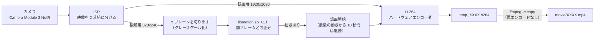

# MyCameraZero2w

Raspberry Pi Zero 2 W（RAM 512MB）の上で動く、動体検知つきの監視カメラです。
動きを検知した間だけ、フル HD（1920x1080）で録画して、MP4 として保存します。

限られた資源（非力な CPU・少ないメモリ）で、**安定して動く画像処理の構成を設計する**ことを目的に作りました。

<!-- TODO: 動作の様子（GIF や画像）を docs/images/ に置いて、ここに貼る -->

## 構成



- 動作の流れ: 検知用の小さな映像で、毎フレーム「前のフレームとの差」を調べる → 動きがあれば録画を始める → 最後に動きを検知してから 10 秒間、動きがなければ止める → 裏で MP4 に変換する。
- 検知は、画面全体のうち、画素の変化量が 30 を超えた画素が 3% を超えたら「動き」と判定します（`--pixel-threshold`、`--change-ratio` で変更できます）。

## 工夫したこと

1. **ISP で映像を 2 系統に分けた**: 録画用は 1920x1080、動体検知用は 320x240。検知のために、フル HD を CPU で処理しなくて済みます。
2. **録画は H.264 のハードウェアエンコーダに任せた**: エンコードの計算を、CPU で行いません。CPU は検知を担当します（ただし、フレームの受け渡しなどの Python 側の処理は残ります。下の「計測結果」を参照）。
3. **YUV420 の Y プレーンを切り出すだけでグレースケールにした**: YUV420 は、先頭が明るさ（Y）なので、色の変換をしないで、白黒の画像が得られます。
4. **画素ごとの差分は C の共有ライブラリで処理した**: Python のループでは遅いため、`libmotion.so` を作り、`ctypes` から呼んでいます。
5. **MP4 化は `ffmpeg -c copy`**: H.264 のデータを、再エンコードせず、MP4 の入れ物に詰め替えるだけです。
6. **設計の変遷を残した**: 下の「設計の変遷」を参照してください。

## 計測結果

Raspberry Pi Zero 2 W の実機で測りました（2026-11-15、各構成 60 秒を 1 回、画面は静止状態）。
計測の条件・手順・生のデータは、[docs/benchmark.md](docs/benchmark.md) と `results/` にあります。

| 構成 | 検知の速さ（fps） | CPU 使用率（1 コア = 100%）平均 | 差分処理 1 回 |
|---|---|---|---|
| 検知用 320x240（本システム） | 17.5 | 46.9% | 約 1.2 ms |
| フル HD を CPU で検知（比較） | 10.4 | 85.7% | 約 30 ms |
| 検知用 320x240 + 録画 | 16.2 | 72.0% | 約 1.3 ms |
| フル HD を CPU で検知 + 録画（比較） | 9.8 | 103.0% | 約 25〜34 ms |

- 録画をしながら比べると、2 系統に分けた構成は、CPU 使用率が 103.0% → 72.0%、fps が 9.8 → 16.2 でした。
- 録画を付けると、本システムの構成でも CPU 使用率は 46.9% → 72.0% に増えました。エンコードの計算はハードウェアが担当していても、Python 側の処理は残るためとみていますが、原因は未確認です。
- 差分処理（C）が使う CPU は、320x240 で約 2%、フル HD で約 31% です。

| 項目 | 結果 |
|---|---|
| 動きが起きてから録画が始まるまでの時間 | TODO: 実測値 |
| 長時間（24 時間）連続でのメモリ推移 | TODO: 実測値（60 秒の計測では、メモリは 100〜280 kB 増えた。増え続けるかは未確認） |
| カメラの切り替え遅延（`experiments/04`） | TODO: 実測値 |

## 設計の変遷

試行錯誤の過程は、`experiments/` に、そのまま残してあります。

| 段階 | ファイル | 内容 |
|---|---|---|
| 1 | [`01_v4l2_capture.c`](experiments/01_v4l2_capture.c) | V4L2 で、センサーの RAW を 1 枚取得する |
| 2 | [`02_v4l2_motion.c`](experiments/02_v4l2_motion.c) | RAW を間引いて、差分で動きを検知する |
| 3 | [`03_libcamera_handoff.py`](experiments/03_libcamera_handoff.py) | 検知後に、`libcamera-vid` へ録画を引き継ぐ |
| 4 | [`04_switch_lag_test.py`](experiments/04_switch_lag_test.py) | 3 の「切り替え」の遅延を計測する |
| 5 | [`05_opencv_avi.py`](experiments/05_opencv_avi.py) | Picamera2 の 2 系統 + OpenCV で、AVI に録画する |
| 6 | [`06_fixed_10s.py`](experiments/06_fixed_10s.py) | H.264 エンコーダで、10 秒固定の録画 + 字幕 |
| 完成 | [`src/surveillance.py`](src/surveillance.py) | 動きが続く間は録画を延長し、番号つきの MP4 を保存する |

各ファイルの先頭にある「何を試したか・なぜ次に進んだか」は、TODO（記入予定）です。

## 既知の課題

- **カメラが固まることがある。** 録画を止めるたびに、カメラを止めて再起動する回避策を入れています（原因は未特定）。調査の手順は [docs/freeze_investigation.md](docs/freeze_investigation.md) にあります。
- **カメラは NoIR（赤外線カットなし）。** 昼間は色が不自然になります。赤外線ライトがあれば、夜間にも映せるはずですが、夜間の動作は未確認です。
- **一部の実験ファイルに、既知の不整合がある。** `02_v4l2_motion.c` は、存在しない `develop.py` を呼びます。`06_fixed_10s.py` は、1 回録画すると終了します。
- **録画データ（`movie/`）と一時ファイルは、実行した場所に作られる。** 保存先を固定する予定です。
- **メモリの長時間の推移、検知から録画開始までの時間は、未計測。**

## ビルドと実行

動作を確認した環境: Raspberry Pi Zero 2 W、Raspberry Pi OS（32bit）、Camera Module 3 NoIR。

```
sudo apt update
sudo apt install -y --no-install-recommends python3-picamera2 python3-numpy ffmpeg gcc make git
git clone https://github.com/togabjto/MyCameraZero2w
cd MyCameraZero2w
make -C src                      # libmotion.so をビルド
python3 src/surveillance.py      # 止めるときは Ctrl+C
```

- 録画は `movie/0001.mp4` のように、番号つきで保存されます。
- 感度を変える: `python3 src/surveillance.py --pixel-threshold 40 --change-ratio 0.05`
- 監視しながら、ブラウザでライブ映像を見る（320x240・白黒、パスワード必須、LAN 内のみ）:
  `TOOLS_PASSWORD=xxxx python3 src/surveillance.py --live-port 8002`
- 詳しい手順とつまずいた点: [docs/setup.md](docs/setup.md)

## デバッグ・計測用のツール

| ツール | 内容 |
|---|---|
| `tools/viewer.py` | 録画をブラウザで再生する（再生・一時停止・10 秒とばし・倍速） |
| `tools/preview.py` | カメラの画角をブラウザで確認する（監視と同時には使えない） |
| `tools/benchmark.py` | 検知ループの fps・CPU・メモリを測って CSV に保存する |
| `tools/sample_process.py` | 動いているプロセスの CPU・メモリを、長時間記録する |

使い方と注意（パスワード必須・LAN 内のみ）は [docs/tools.md](docs/tools.md) を参照してください。

## ディレクトリ構成

```
src/          監視本体（surveillance.py、motion.c、Makefile）
experiments/  試行錯誤の記録（設計の変遷）
tools/        デバッグ・計測用のツール
docs/         セットアップ、計測、調査の資料
results/      計測の生データ（CSV）
```
